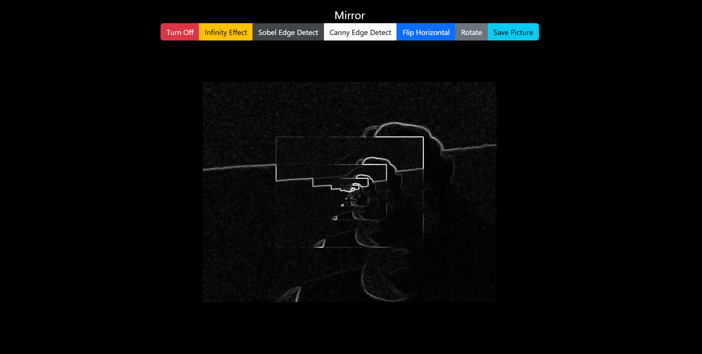

# Mirror

A browser based webcam mirror with real time visual effects.

## What is this?

This web creates an infinity mirror effects using the browser webcam.It includes functionalities such as flipping the video feed horizontally, applying an infinity mirror effect, rotating the image, and saving the current view as an image file. The project leverages HTML, CSS, and JavaScript with Bootstrap for styling, and it operates entirely in the browser using the WebRTC API for real-time video processing.

## How to try it

## Tech used

JS for all the image processing,HTML5 Canvas to render the webcam feed and applies effects in real time,Mediadevice api to grab the API.